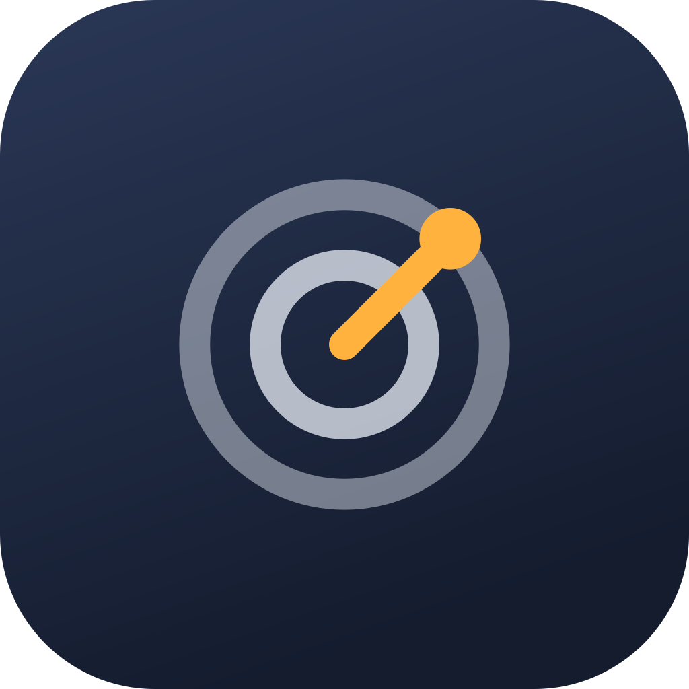

<p align="center">
  
</p>

<h1 align="center">Deadline Radar</h1>

<p align="center">
  Every course deadline in one place, with reminders and an AI assistant that knows your courses.<br>
  SwiftUI iPhone prototype · IT 3002 Software Project Management · Team 11 · International Burch University
</p>

---

## What it is

Students track deadlines across Moodle, GitHub, e-mail and lecturer slides, so assignments get missed or started too late. Deadline Radar collects every deadline into one view and reminds you before it is due.

This repository is the **clickable UI prototype** for the iPhone. It has **no backend yet**: all data is mock data, and Moodle sync, push notifications and the AI chat come later.

## Screens

| Tab | What it shows |
|---|---|
| **Home** | Today header, week strip, next deadlines coloured by urgency, a weekly summary and the month calendar |
| **Chat** | "Radar AI", a chat assistant that will be connected to the university and Moodle (placeholder replies for now) |
| **Profile** | Student card, connected sources (Moodle, iCal), reminder settings and app info. No sign-up yet |

Navigation is the system bottom tab bar, which on iOS 26 is a floating **Liquid Glass** bar.

## Design

The chosen direction is **L3 · Radar Day** for light mode and **Phosphor** for dark mode.

| Token | Light | Dark |
|---|---|---|
| Background | `#EAEEF4` mist | `#0C1018` ink |
| Text | `#16203A` | `#F3EEE3` |
| Ink (icons, active tab) | `#24324F` | `#F3EEE3` / amber tab |
| Amber (fills only) | `#FFB23E` | `#FFB23E` |
| Urgent (due today) | `#CC3A22` | `#FF6B4F` |

Rules:

- Amber is only ever a **fill** (selected day, today, your chat bubbles, the send button) with ink text on top, never a text colour on a light background.
- Every surface is **Liquid Glass** (`.glassEffect`) over the radar background: faint rings sweeping from the top corner plus one amber glow.
- Deadlines are coloured by urgency: red = due within 24 h, amber = this week, faded ink = later.

All design rounds (logos, palettes, light-mode versions) are in [`design/`](design/). Open `design/index.html` in a browser to compare them.

## Run it

Requirements: a Mac with **Xcode 26** (iOS 26 SDK, for Liquid Glass).

1. Clone the repo and open `DeadlineRadar.xcodeproj`.
2. Pick an iPhone simulator and press **Run** (⌘R).
3. Toggle light and dark mode in the simulator (**Features → Toggle Appearance**, ⇧⌘A), or use the Light and Dark SwiftUI previews in each view.

The project uses Xcode's synchronized folders: any file you add under `DeadlineRadar/` is part of the app automatically, without editing the project file.

## Project structure

```
DeadlineRadar/
  DeadlineRadarApp.swift     app entry + bottom tab bar (RootView)
  Theme/Theme.swift          colour tokens (light/dark) and the glassCard() style
  Theme/RadarBackground.swift radar background and the logo mark, drawn in code
  Models/MockData.swift      fake deadlines and chat messages
  Views/HomeView.swift       Home tab
  Views/ChatView.swift       Chat tab
  Views/ProfileView.swift    Profile tab
  Assets.xcassets            app icon and accent colour
assets/                      logo (SVG), app icon (SVG + 1024 px PNG)
design/                      HTML design explorations
```

## Project management

The planning work for this project (charter, WBS, schedule, RACI, kick-off pack, sprints) lives in the course repository:
**[ibu-it3002-2026/team-11](https://github.com/ibu-it3002-2026/team-11)** (private, course members only).

## Team

| Member | Role |
|---|---|
| Nadža Hasanović ([@itnadza](https://github.com/itnadza)) | Project manager, mobile developer |
| Haris Skeledžija ([@Haris0059](https://github.com/Haris0059)) | Lead developer |
| Emina Tahirović ([@eminatahirovic](https://github.com/eminatahirovic)) | Analyst, tester |

## Roadmap

- [x] Logo, colour system and light/dark design
- [x] UI scaffold: Home, Chat, Profile with Liquid Glass
- [ ] Manual deadline entry and edit screen
- [ ] Reminder configuration screen
- [ ] Moodle iCal import
- [ ] Push notifications
- [ ] AI chat backend
